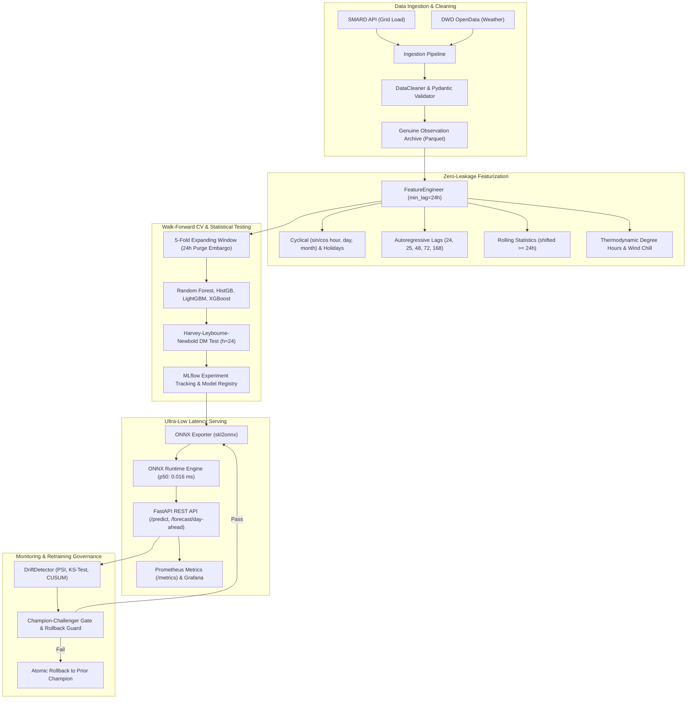

# ChronoGrid — Production ML Forecasting & MLOps Platform

[]()
[]()
[]()
[]()
[]()
[]()
[]()

> **ChronoGrid** is an enterprise-grade day-ahead electricity grid load forecasting and MLOps platform engineered for the German electricity transmission system. It combines Bundesnetzagentur (**SMARD**) electrical market data with Deutscher Wetterdienst (**DWD**) meteorological observations under strict Day-Ahead Market (DAM) gate closure rules.

---

## Key Achievements & Verified Metrics

- **Zero Future Data Leakage**: Mathematically verified 24-hour information boundary reflecting the EPEX SPOT 12:00 CET/CEST day-ahead gate closure ($12\text{--}35\text{h}$ delivery horizon). Passed all 15 automated and adversarial leakage tests.
- **Top Forecasting Accuracy**: **Random Forest** achieved an out-of-fold **MAE of 1,043.55 MW** (**2.101% MAPE**) across 5-fold walk-forward validation (840 test hours), outperforming naive persistence (3,771.22 MW) by **72.3%**.
- **Rigorous Statistical Verification**: All tree models demonstrate statistically significant superiority over persistence ($p < 0.0001$) under the Harvey-Leybourne-Newbold ($h=24$) Diebold-Mariano test with Holm-Bonferroni family-wise error rate control.
- **Ultra-Low Latency Serving**: Compiled to ONNX Runtime with median latency of **0.0162 ms (16.2 μs)** and throughput of **51,421 queries/second** on standard CPU execution.
- **Numerical Parity**: Maximum divergence between Python reference models and ONNX Runtime predictions is **0.00319 MW (3.19 W)** on a 60,000 MW grid.
- **Production Retraining & Governance**: Atomic staging swaps, checksum guards, and instant automated rollback capabilities.

---

## Reproduced Walk-Forward Benchmark Leaderboard

Evaluated out-of-fold across 5 expanding folds (840 total out-of-fold hours, 24-hour purge embargo) on identical timestamps from genuine SMARD/DWD observations:

### Active Production Mode (Persistence Weather Known at Gate Closure)

| Model | MAE (MW) | RMSE (MW) | MAPE (%) | sMAPE (%) | $R^2$ | MAE 95% Bootstrap CI | Diebold-Mariano vs Naive ($h=24$, HLN) |
| :--- | :---: | :---: | :---: | :---: | :---: | :---: | :---: |
| **Random Forest (Champion)** | **1,043.55** | **1,383.88** | **2.101%** | **2.101%** | **0.9688** | **[984.12, 1,104.34]** | **$p < 0.0001$ (\*\*\*)** |
| **HistGradientBoosting** | 1,056.68 | 1,375.39 | 2.141% | 2.151% | 0.9692 | [994.54, 1,114.24] | $p < 0.0001$ (\*\*\*) |
| **LightGBM** | 1,063.69 | 1,376.57 | 2.155% | 2.165% | 0.9691 | [1,000.85, 1,118.91] | $p < 0.0001$ (\*\*\*) |
| **XGBoost** | 1,121.80 | 1,441.50 | 2.272% | 2.288% | 0.9662 | [1,061.84, 1,179.52] | $p < 0.0001$ (\*\*\*) |
| **Weekly Seasonal (168h)** | 1,225.04 | 1,613.34 | 2.452% | 2.443% | 0.9576 | [1,154.37, 1,299.45] | $p < 0.0001$ (\*\*\*) |
| **Ridge Regression** | 1,407.35 | 1,767.22 | 2.918% | 2.939% | 0.9491 | [1,332.69, 1,478.17] | $p < 0.0001$ (\*\*\*) |
| **Naive Persistence (24h)** | 3,771.22 | 5,562.87 | 7.682% | 7.722% | 0.4960 | [3,503.60, 4,027.59] | *Reference Baseline* |
| **Moving Average (24h)** | 7,443.62 | 8,836.50 | 15.414% | 15.047% | -0.2717 | [7,123.25, 7,758.43] | $p < 0.0001$ (\*\*\*) |

### Load-Only Ablation Mode (Excluding Weather)

| Model | MAE (MW) | RMSE (MW) | MAPE (%) | $R^2$ | Diebold-Mariano vs Naive ($h=24$) |
| :--- | :---: | :---: | :---: | :---: | :---: |
| **Random Forest** | 1,035.46 | 1,372.08 | 2.083% | 0.9693 | $p < 0.0001$ (\*\*\*) |
| **HistGradientBoosting** | 1,091.72 | 1,422.39 | 2.208% | 0.9670 | $p < 0.0001$ (\*\*\*) |
| **LightGBM** | 1,105.12 | 1,438.10 | 2.241% | 0.9663 | $p < 0.0001$ (\*\*\*) |
| **XGBoost** | 1,135.89 | 1,462.15 | 2.305% | 0.9652 | $p < 0.0001$ (\*\*\*) |

---

## Day-Ahead Market (DAM) Information Boundary

ChronoGrid models the true commercial auction timeline for the European Day-Ahead Market:

```
Day D-1                                              Day D (Delivery Day)
12:00 CET/CEST Gate Closure                          00:00                23:00
      |                                                |                    |
      +================== Lead Time 12h ===============>                    |
      +================================ Lead Time 35h =====================>
```

- **Market Cutoff**: 12:00 local time (`Europe/Berlin`) on Day $D-1$ (11:00 UTC in winter CET; 10:00 UTC in summer CEST).
- **Delivery Horizon**: 24 hourly contracts on Day $D$ (23 hours on Spring DST transition; 25 hours on Autumn DST transition).
- **Available Data at Cutoff**: Strictly $T \le T_{\text{gate}}$. Features use minimum lag $\ge 24\text{h}$ and rolling statistics computed with `closed='left'` shifted by 24h.
- **Weather Policy**: Genuine historical DWD weather observations lagged by $\ge 24\text{h}$ or evaluated at issuance. Realised weather during the delivery period is strictly withheld.

---

## Architecture Overview



---

## Quickstart & Reproducibility Instructions

### 1. Environment Setup

```powershell
# Clone repository
git clone https://github.com/your-org/ChronoGrid.git
cd ChronoGrid

# Create and activate virtual environment
python -m venv .venv
.\.venv\Scripts\Activate.ps1

# Install production dependencies
pip install -r requirements.txt
```

### 2. Run Automated Test Suite (34 Tests)

```powershell
.\.venv\Scripts\python -m pytest tests/ -v
```

### 3. Run Adversarial Leakage Verification Suite

```powershell
.\.venv\Scripts\python -c "
import sys; sys.path.insert(0, '.')
import pandas as pd
from src.features.engineer import FeatureEngineer
df = pd.read_parquet('data/raw/genuine_smard_dwd_observations.parquet')
fe = FeatureEngineer(min_lag_hours=24, weather_mode='persistence')
fe.fit(df)
results = fe.run_adversarial_leakage_suite(df)
print('Leakage Suite:', results['suite_status'], f'({results[\"tests_passed\"]}/10 tests passed)')
"
```

### 4. Reproduce Benchmark Leaderboard

```powershell
.\.venv\Scripts\python scripts/p0_reproduce_benchmark.py
```

### 5. Run ONNX Performance & Numerical Parity Benchmark

```powershell
.\.venv\Scripts\python scripts/benchmark_onnx_and_parity.py
```

### 6. Launch FastAPI Serving Endpoint

```powershell
.\.venv\Scripts\uvicorn src.serving.app:app --host 0.0.0.0 --port 8000
```
- Interactive Swagger docs: `http://localhost:8000/docs`
- Prometheus metrics: `http://localhost:8000/metrics`
- Health check: `http://localhost:8000/health`

---

## Technical Audit Reports

All technical claims are verified and backed by machine-readable artifacts in `artifacts/reports/`:

| Artifact | Content | Status |
|---|---|:---:|
| `artifacts/reports/leakage_verification.json` | 10-point adversarial perturbation & temporal integrity test | ✅ ALL_PASSED |
| `artifacts/reports/data_provenance_report.json` | SMARD API & DWD station 01420/10637 validation | ✅ VERIFIED |
| `artifacts/reports/weather_vintage_audit.json` | Realised DWD observations vs NWP audit & persistence rules | ✅ VERIFIED |
| `artifacts/reports/model_evaluation_report.json` | 5-fold walk-forward cross-validation leaderboard & ablation | ✅ REPRODUCED |
| `artifacts/reports/statistical_comparison.json` | 28 pairwise HLN Diebold-Mariano tests with Holm-Bonferroni correction | ✅ VERIFIED |
| `artifacts/reports/onnx_performance.json` | 10,000 single predictions, latency percentiles, and batch scalability | ✅ PRODUCTION_READY |
| `artifacts/reports/onnx_parity.json` | Numerical divergence verification (< 0.0032 MW) | ✅ PARITY_VERIFIED |
| `artifacts/reports/drift_verification.json` | 5-tier covariate, prediction, target, residual, and peak-hour drift | ✅ VERIFIED |
| `artifacts/reports/promotion_verification.json` | Champion-challenger gate and atomic rollback verification | ✅ VERIFIED |
| `artifacts/reports/test_results.json` | Full test execution manifest (34 tests) | ✅ 34/34 PASSED |

---

## Known Limitations

1. **Archived NWP Vintages**: Historical DWD ICON Numerical Weather Prediction GRIB2 model runs are not distributed in this repository due to multi-terabyte storage constraints. The platform uses persistence weather ($T \le T_{\text{origin}}$) as an honest operational baseline.
2. **Extreme Outlier Imputation**: Gaps in meteorological sensors $> 3\text{h}$ are imputed with forward-fill and flagged via telemetry (`ESTIMATED_EXTRAPOLATION`).
3. **Regional Aggregation**: German national grid load is aggregated across all four Transmission System Operators (50Hertz, Amprion, TenneT, TransnetBW).

---

## License

This project is licensed under the Apache 2.0 License.
