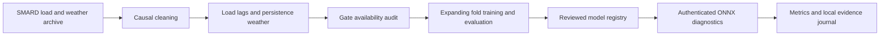

# ChronoGRID

[](https://github.com/pavann19/ChronoGRID/actions/workflows/ci.yml)
[](LICENSE)

I built ChronoGRID to study day-ahead electricity-load forecasting for Germany and to make its information boundary inspectable. The repository contains data ingestion, causal feature generation, a German market-gate audit, reproducible evaluation, and authenticated ONNX diagnostics. I treat the results as retrospective research and a local engineering demonstration.

## What the audit changed

The original 24-hour-lag result used observation intervals ending after the previous-day noon gate on 420 of 840 delivery hours. I withdrew its day-ahead accuracy and information-boundary claims. The corrected default uses 48-hour lags. In the new expanding-fold run, Random Forest has MAE **1,146.79 MW**, compared with **1,225.04 MW** for weekly persistence. This is a lower mean error on reused historical dates; it is not evidence of a prospective or production advantage. The earlier fixed-model experiment remains preserved and uses a different training protocol.

## Reproduced results

I used 5 expanding folds, a 24-hour purge, and 35 reused Berlin delivery days. Each model stays fixed during its test week; features update at the daily gate. The intervals use 2,000 circular bootstrap replicates of two-day blocks. MAE, RMSE, MAPE and all interval endpoints are saved in [metrics.csv](artifacts/reports/benchmark_corrected/metrics.csv); [hourly predictions](artifacts/reports/benchmark_corrected/per_hour_predictions.csv.gz), [fold boundaries](artifacts/reports/benchmark_corrected/folds.csv), and [run metadata](artifacts/reports/benchmark_corrected/report.json) support the table.

| Model | MAE (MW) | MAE 95% block CI | RMSE (MW) | MAPE |
|---|---:|---:|---:|---:|
| RandomForest | 1,146.79 | [962.90, 1,334.72] | 1,507.61 | 2.306% |
| HistGradientBoosting | 1,158.74 | [1,001.43, 1,313.62] | 1,479.24 | 2.344% |
| LightGBM | 1,183.73 | [1,023.08, 1,339.43] | 1,501.98 | 2.392% |
| Weekly_168h | 1,225.04 | [1,019.75, 1,444.71] | 1,613.34 | 2.452% |
| XGBoost | 1,279.76 | [1,082.36, 1,495.53] | 1,625.82 | 2.575% |
| TSO_latest_revision | 1,497.48 | [1,325.24, 1,695.23] | 1,833.05 | 2.963% |
| Ridge | 1,535.64 | [1,296.82, 1,792.22] | 1,950.91 | 3.120% |
| Naive_48h | 6,268.20 | [4,776.56, 7,647.90] | 8,144.84 | 12.888% |

`TSO_latest_revision` is SMARD's published load forecast downloaded for the same hours. It is a retrospective reference: the download has no original issuance timestamp and can include revisions. Confidence intervals for individual models do not establish a paired significance claim.

<details>
<summary>Explicitly leaky 24-hour comparison — excluded from day-ahead claims</summary>

| Model | MAE (MW) | MAE 95% block CI | RMSE (MW) | MAPE |
|---|---:|---:|---:|---:|
| RandomForest | 1,043.55 | [877.80, 1,221.55] | 1,383.88 | 2.101% |
| HistGradientBoosting | 1,057.98 | [896.15, 1,230.50] | 1,383.67 | 2.142% |
| LightGBM | 1,071.48 | [915.26, 1,236.00] | 1,389.76 | 2.168% |
| XGBoost | 1,120.60 | [954.70, 1,301.45] | 1,439.58 | 2.268% |
| Weekly_168h | 1,225.04 | [1,019.75, 1,444.71] | 1,613.34 | 2.452% |
| Ridge | 1,411.13 | [1,231.99, 1,596.89] | 1,774.53 | 2.925% |
| Naive_24h | 3,771.22 | [2,786.62, 4,767.75] | 5,562.87 | 7.682% |

</details>

## Run locally on Linux

```sh
git clone https://github.com/pavann19/ChronoGRID.git
cd ChronoGRID
python3 -m venv .venv
. .venv/bin/activate
make install
make lint
make test
make audit
make benchmark
export CHRONOGRID_DIAGNOSTICS_TOKEN="$(python -c 'import secrets; print(secrets.token_urlsafe(32))')"
make serve
```

`make audit` checks dependencies and feature availability. A dependency advisory is a failing check, not an approval. `/health` is open; `/predict`, `/model/info` and `/metrics` require the diagnostics bearer token. Forecast replay routes require a separate replay token and remain disabled by default. The bundled ONNX models are historical diagnostic artifacts; I have not promoted the corrected benchmark model into serving.

## Run with Docker

```sh
make docker
docker run --rm -p 127.0.0.1:8000:8000 \
  -e CHRONOGRID_DIAGNOSTICS_TOKEN chronogrid:0.2.0
```

The Dockerfiles install hash-locked dependencies during the build and need no ignored wheelhouse. Build and validation evidence, including any unresolved checks, is in [the cleanup report](artifacts/reports/cleanup_report.md).

## Architecture



A registry entry binds the served model and metadata bytes. Training/evaluation results require a separate review before a serving artifact is changed. [Architecture](docs/architecture.md), [operations](docs/operations.md), and [runbook](docs/runbook.md) describe these boundaries.

## Limits

I have about 19 months of data and only 35 reused evaluation days. Weather features are persistence from a historical archive, not timestamped NWP forecast vintages. The gate audit checks completed observation intervals; it does not reconstruct actual publication delays or later revisions. The historical weather download used Open-Meteo; its legacy filename and source label do not prove direct DWD station provenance. I have no external timestamped prospective evidence and make no production-readiness claim. [Provenance and limitations](docs/provenance_and_limitations.md) records the details.

## Sources and licensing

Load data: **Bundesnetzagentur | SMARD.de**, under [SMARD's CC BY 4.0 data-use terms](https://www.smard.de/home/datennutzung). [Weather data by Open-Meteo.com](https://open-meteo.com/), under its [data licence](https://open-meteo.com/en/licence). DWD open data is credited as **Deutscher Wetterdienst (DWD)** where used by the separate ICON adapter; its [CDC terms](https://opendata.dwd.de/climate_environment/CDC/Terms_of_use.pdf) specify CC BY 4.0. I checked these sources on 2026-11-10. [NOTICE](NOTICE) describes attribution and transformations; the code uses [Apache-2.0](LICENSE).
