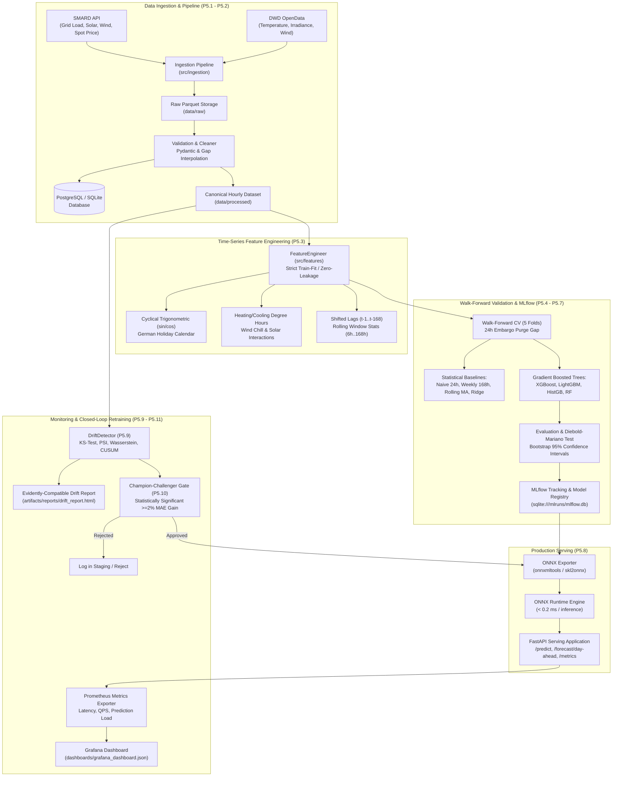
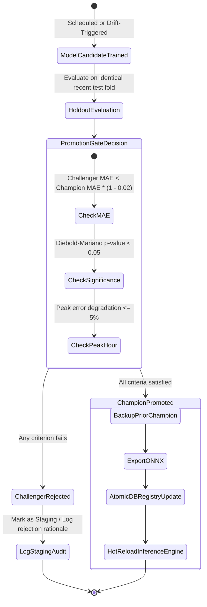

# ChronoGrid System Architecture

ChronoGrid is an end-to-end, production-grade ML forecasting and MLOps platform engineered for high-precision Day-Ahead Electricity Grid Load forecasting in Germany, fusing Bundesnetzagentur (SMARD) market data with Deutscher Wetterdienst (DWD) meteorological observations.

---

## 1. High-Level System Architecture

---

## 2. Walk-Forward Cross-Validation Strategy

To ensure zero future-data leakage and accurately mimic day-ahead dispatch conditions (gate closure at 12:00 CET for delivery the next day):

```mermaid
gantt
    title Walk-Forward Validation with 24h Purge Embargo
    dateFormat X
    axisFormat %s
    section Fold 1
    Train (90 Days)      :done, 0, 90
    24h Purge Embargo    :crit, 90, 91
    Test (1 Week)        :active, 91, 98
    section Fold 2
    Train (Expanding)    :done, 0, 98
    24h Purge Embargo    :crit, 98, 99
    Test (1 Week)        :active, 99, 106
    section Fold 3
    Train (Expanding)    :done, 0, 106
    24h Purge Embargo    :crit, 106, 107
    Test (1 Week)        :active, 107, 114
    section Fold 4
    Train (Expanding)    :done, 0, 114
    24h Purge Embargo    :crit, 114, 115
    Test (1 Week)        :active, 115, 122
    section Fold 5
    Train (Expanding)    :done, 0, 122
    24h Purge Embargo    :crit, 122, 123
    Test (1 Week)        :active, 123, 130
```

---

## 3. Champion-Challenger Promotion State Machine

